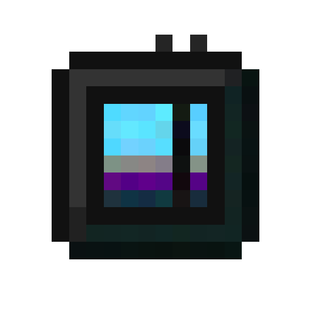

# Hostile Neural Networks for Sunrise

Train data models on the mobs you fight, then simulate those mobs in machines to farm their drops: the Deep Learner,
the Simulation Chamber, the Loot Fabricator and the Data Center, on [Sunrise](https://playsunrise.net)
(Minecraft Java 26.3).

**Sunrise port by Joeypc6, based on [Hostile Neural Networks](https://github.com/Shadows-of-Fire/Hostile-Neural-Networks)
by Shadows_of_Fire.** The code is a rewrite on Sunrise's mod API that follows the original 7.0.0 release; the
textures, models, recipes and language files are the original's. This is an unofficial port, not made or endorsed by
the original author.

- **Mod id:** `hostilenetworks`
- **Licence:** MIT, the same as the original. See [`LICENSE`](LICENSE).
- **Optional mods:** JEI (the Loot Fabricator's recipes), Jade (the IO port's mode) and GuideME (the W guide).

## Install

1. Open the Sunrise launcher and select your instance.
2. Open **Mods**, find **Hostile Neural Networks** in Discover, and install it. The launcher installs what it needs
   and builds the mod for your game.
3. The mod is native code, which is not sandboxed: the launcher asks you to trust it before building it.

Each release fits the Sunrise builds it was made for; the launcher only offers it for those.

## Reporting problems

Open an issue in this repository. Please don't report problems with this port to the original mod's author.
